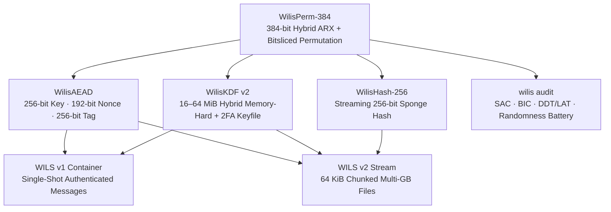

<div align="center">

# WILIS

### Standalone, Zero-Dependency Custom Cryptography Suite in Pure Rust

[](https://github.com/wiersect/wilis/actions/workflows/ci.yml)
[](https://github.com/wiersect/wilis/releases)
[](https://www.rust-lang.org/)
[](Cargo.toml)
[](SPECIFICATION.md)
[](LICENSE)

*One original 384-bit permutation. Zero external crypto libraries. Built from scratch for authenticated encryption, memory-hard key derivation, constant-memory streaming, hashing, and live cryptanalysis.*

[Philosophy](#design-philosophy) · [Specification](SPECIFICATION.md) · [Audit Results](#verified-cryptanalysis--benchmarks) · [CLI Quickstart](#cli-quickstart) · [Rust API](#rust-library-usage) · [Security](SECURITY.md)

</div>

---

## Overview

**Wilis** is an independent, self-contained cryptographic suite engineered entirely in pure Rust (`std` only). Rather than composing external primitives like AES, SHA-256, ChaCha20, or Argon2, every cryptographic capability in Wilis derives strictly from a single original **384-bit bijective permutation (`WilisPerm-384`)**:

| Component | Purpose | Key Properties |
| :--- | :--- | :--- |
| **`WilisPerm-384`** | Core 384-bit cryptographic permutation | Hybrid ARX + bitsliced `Chi-5`/`Feistel-6` + invertible 3-tap diffusion; 100% constant-time, zero S-Box lookup tables |
| **`WilisAEAD`** | Authenticated Encryption with Associated Data | 256-bit key, 192-bit nonce, 256-bit tag, 256-bit sponge capacity, dual key whitening, key-commitment |
| **`WilisKDF` v2** | Hybrid memory-hard password KDF | **16 MiB – 64 MiB RAM**, data-independent Pass 0 + data-dependent Passes `1..T`, optional **2FA Keyfile** |
| **`WilisHash-256`** | Incremental cryptographic sponge hash | 256-bit digest, 128-bit collision resistance margin, streaming & one-shot APIs |
| **`WILS` v2 Stream** | Constant-memory chunked file encryption | 64 KiB authenticated chunks, < 1 MiB RAM on multi-GB files, anti-truncation & anti-reordering |
| **`wilis audit`** | Built-in scientific cryptanalysis engine | Round-by-round SAC (1–16), BIC, exact DDT/LAT for `Chi-5`, NIST-style randomness battery |



---

## Design Philosophy

1. **Single-Primitive Purity (Zero External Dependencies):**
   `[dependencies]` in [`Cargo.toml`](Cargo.toml) is intentionally empty. Cryptography, OS CSPRNG (`/dev/urandom`), Base64, Hex, constant-time equality, hidden password prompting, and volatile memory zeroization are all implemented cleanly in pure Rust.
2. **Cache-Timing-Resistant Hybrid Nonlinearity:**
   No secret-dependent memory lookup tables exist anywhere in the cipher. Every round blends arithmetic carry-chain nonlinearity (**64-bit ARX**), boolean cross-word nonlinearity (**bitsliced `Chi-5` + `Feistel-6`**), and provably invertible **3-tap intra-word diffusion** over $\mathrm{GF}(2)[t]/(t^{64}+1)$.
3. **Transparent *Nothing-Up-My-Sleeve* Constants:**
   All 32 round constants are computed directly as $\lfloor 2^{64} \cdot \mathrm{frac}(p_i^{1/5}) \rfloor$ for the first 32 prime numbers $p_1 = 2, \dots, p_{32} = 131$.
4. **Anti-Brute-Force Defense in Depth:**
   Passphrase derivation enforces 16 MiB (`interactive`), 32 MiB (`high`), or 64 MiB (`paranoid`) of memory-hard work plus optional 2-factor keyfiles (`--keyfile`) and hidden terminal prompts (`--pass-prompt`) to keep secrets out of shell history.

For the full mathematical and wire-format specification, see **[`SPECIFICATION.md`](SPECIFICATION.md)**.

---

## Verified Cryptanalysis & Benchmarks

Measured directly on `x86_64` Linux via `./target/release/wilis audit` and `./target/release/wilis bench`:

| Test / Metric | Measured Result | Target / Ideal | Status |
| :--- | :--- | :--- | :---: |
| **Bijectivity** `P⁻¹(P(x)) == x` | Exact identity across rounds 1, 4, 12, 16 | Exact 1-to-1 bijection | **PASS** |
| **Full Diffusion Round** (SAC 384-bit) | **Round 2** (`191.98/384` = `49.99%`) | ≤ Round 4 (10–14 round margin) | **PASS** |
| **Full-Round Avalanche** (Round 16) | **`191.99 / 384` bits (`50.00%`)** | `192.00` bits (`50.00%`) | **PASS** |
| **Bit Independence Criterion (BIC)** | Avg `\|corr\| = 0.0348`, Max `0.1641` | Avg `< 0.06`, Max `< 0.25` | **PASS** |
| **`Chi-5` S-Box Exact DDT / LAT** | Bijective, Diff Unif `8`, Nonlinearity `8` | Paired with ARX degree-63 carries | **PASS** |
| **Keystream Monobit Ratio** (128 KiB) | `0.50007` | `0.50000` (`Z < 3.29`) | **PASS** |
| **Keystream Runs Test** | `Z = 0.8701` | `Z < 3.29` | **PASS** |
| **Keystream Shannon Entropy** | **`7.99853` bits/byte** | `> 7.995` (max `8.000`) | **PASS** |
| **Keystream Chi-Squared** (255 df) | `267.85` | `[170 .. 350]` | **PASS** |
| **Keystream Autocorrelation** (lags 1–16) | `0.00591` | `< 0.025` | **PASS** |
| **`WilisAEAD` Throughput** (Release) | **`~218–251 MiB/s`** (pure Rust, no SIMD) | Authenticated 256-bit security | **PASS** |
| **Integration & Security Test Suite** | **`17 / 17` tests passing** | Zero warnings, zero failures | **PASS** |

---

## Build & Verify

```bash
git clone https://github.com/wiersect/wilis.git
cd wilis

# Run the complete unit, security, streaming, and cryptanalysis test suite
cargo test

# Build optimized release binary (LTO enabled)
cargo build --release

# Run full scientific cryptanalysis audit & throughput benchmarks
./target/release/wilis audit
./target/release/wilis bench
```

---

## CLI Quickstart

```bash
# Generate a fresh 256-bit random key and its WilisHash-256 fingerprint
./target/release/wilis keygen

# Encrypt & decrypt text using a hidden password prompt (safe from shell history)
./target/release/wilis encrypt-text --pass-prompt --strength paranoid "Hello Wilis!"
./target/release/wilis decrypt-text --pass-prompt "<BASE64_CONTAINER>"

# Stream-encrypt a large binary file with 2-Factor (Passphrase + Keyfile)
./target/release/wilis encrypt-file \
  --pass-prompt \
  --keyfile secret.key \
  --strength high \
  --aad "backup-2026" \
  --in archive.tar \
  --out archive.wils

# Authenticate and stream-decrypt (auto-detects WILS v1 or v2; wipes output on any tamper)
./target/release/wilis decrypt-file \
  --pass-prompt \
  --keyfile secret.key \
  --aad "backup-2026" \
  --in archive.wils \
  --out restored.tar

# Compute a 256-bit WilisHash-256 digest of text or a file
./target/release/wilis hash "Wildan & Elis"
./target/release/wilis hash --file archive.tar
```

### KDF Strength Presets

| Preset | Memory Cost | Passes | Ideal Use Case |
| :--- | :---: | :---: | :--- |
| `--strength interactive` *(default)* | **16 MiB** | 3 | Fast daily text & file encryption (~200 ms) |
| `--strength high` | **32 MiB** | 4 | Sensitive personal documents & backups |
| `--strength paranoid` | **64 MiB** | 6 | Maximum offline brute-force defense |

---

## Rust Library Usage

```rust
use wilis::aead::{open, seal};
use wilis::utils::random::{generate_key, generate_nonce};

fn main() -> wilis::Result<()> {
    let key = generate_key()?;
    let nonce = generate_nonce()?;
    let aad = b"context:v1";
    let plaintext = b"Authenticated payload protected by WilisAEAD.";

    let (ciphertext, tag) = seal(key.as_bytes(), &nonce, aad, plaintext);
    let recovered = open(key.as_bytes(), &nonce, aad, &ciphertext, &tag)?;

    assert_eq!(recovered, plaintext);
    Ok(())
}
```

---

## Repository Layout

Every domain lives cleanly at the repository root with one responsibility per file:

```text
wilis/
├── Cargo.toml                  # Zero-dependency crate manifest
├── README.md                   # Overview, audit metrics, and usage
├── SPECIFICATION.md            # Formal mathematical & wire-format spec
├── SECURITY.md                 # Threat model & security policy
├── CHANGELOG.md                # Release history
├── LICENSE                     # MIT License
├── lib.rs / main.rs / error.rs # Library, binary, and error entry points
├── core/                       # WilisPerm-384 (constants, state, arx, sbox, diffusion, permute)
├── aead/                       # WilisAEAD (init, absorb, encrypt, decrypt, finalize, cipher)
├── kdf/                        # WilisKDF v2 (params, hybrid memory_kdf)
├── hash/                       # WilisHash-256 (sponge_hash)
├── format/                     # WILS v1 & v2 container headers and sealing
├── stream/                     # Constant-memory chunked streaming AEAD (WILS v2)
├── audit/                      # Scientific cryptanalysis suite (SAC, BIC, DDT/LAT, randomness)
├── utils/                      # Constant-time eq, volatile zeroize, CSPRNG, prompt, Hex, Base64
├── cli/                        # Zero-dependency CLI commands & parser
└── tests/                      # 17 integration, security, streaming, and audit tests
```

---

## Security Notice

> **Important:** Wilis is a custom, independent cryptographic design built for education, cryptographic engineering research, and personal experimentation. Like any newly invented cipher, it has not undergone multi-year external public cryptanalysis. Do **not** use custom cryptography as the sole protection for regulated, financial, or mission-critical production systems — use peer-reviewed standards such as AES-GCM, ChaCha20-Poly1305, and Argon2id for production workloads.

See **[`SECURITY.md`](SECURITY.md)** for full details.

---

## License

Licensed under the **[MIT License](LICENSE)**.
