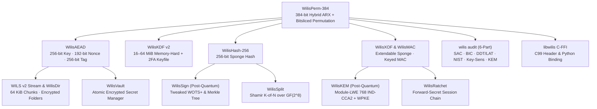

<div align="center">

# WILIS

### Standalone Post-Quantum & Symmetric Cryptography Suite in Pure Rust

[](https://github.com/wiersect/wilis/actions/workflows/ci.yml)
[](https://github.com/wiersect/wilis/releases)
[](https://www.rust-lang.org/)
[](Cargo.toml)
[](.github/workflows/ci.yml)
[](LICENSE)

*One original 384-bit permutation. Zero external crypto libraries. Post-quantum public-key encryption (Module-LWE KEM), post-quantum signatures (WOTS+ Merkle), AEAD, 16–64 MiB memory-hard KDF, forward-secret session ratchet, Shamir secret sharing, XOF/MAC, encrypted folders & vaults, cross-platform C/Python bindings, and 6-part live cryptanalysis.*

[Architecture](#architecture) · [Specification](SPECIFICATION.md) · [Audit Results](#verified-cryptanalysis--benchmarks) · [CLI Quickstart](#cli-quickstart) · [C / Python FFI](#c--python-bindings) · [Security](SECURITY.md)

</div>

---

## Overview

**Wilis** is a self-contained cryptographic engineering suite written 100% in pure Rust (`std` only, **zero external dependencies**). Every primitive derives strictly from a single original **384-bit bijective permutation (`WilisPerm-384`)**:

| Module | Primitive | Key Security Guarantees |
| :--- | :--- | :--- |
| **`core/`** | **`WilisPerm-384`** | Hybrid ARX + constant-time bitsliced `Chi-5`/`Feistel-6` + invertible 3-tap diffusion; zero S-Box lookup tables |
| **`aead/`** | **`WilisAEAD`** | 256-bit key, 192-bit nonce, 256-bit tag, 256-bit sponge capacity, dual key whitening, key-commitment |
| **`kem/`** | **`WilisKEM`** | **Post-quantum** Module-LWE (`k=3`, `N=256`, `q=7681`, `49σ` margin) IND-CCA2 KEM + hybrid public-key encryption (`WPKE`) |
| **`sign/`** | **`WilisSign`** | **Post-quantum** stateful hash-based signatures (`WOTS+` + Merkle tree) built strictly from `WilisHash-256` |
| **`ratchet/`** | **`WilisRatchet`** | Forward-secret symmetric messaging ratchet with bounded out-of-order delivery & anti-replay/DoS protection |
| **`kdf/`** | **`WilisKDF` v2** | **16–64 MiB** hybrid memory-hard KDF (data-independent Pass 0 + data-dependent Passes `1..T`) + **2FA Keyfile** |
| **`hash/`** | **`WilisHash-256`** | Incremental & one-shot 256-bit sponge hash with 128-bit collision resistance margin |
| **`xof/`** | **`WilisXOF`** | Arbitrary-length domain-separated Extendable-Output Sponge Function & deterministic PRNG |
| **`mac/`** | **`WilisMAC`** | Keyed 256-bit sponge MAC (length-extension immune) + domain-separated `derive_subkey` |
| **`split/`** | **`WilisSplit`** | Information-theoretic **Shamir's Secret Sharing** (`K`-of-`N`) over constant-time `GF(2^8)` with commitment check |
| **`stream/`** | **`WILS` v2 Stream** | Constant-memory 64 KiB chunked streaming AEAD blocking truncation, reordering, duplication, and tampering |
| **`archive/`** | **`WilisDir`** | Custom recursive folder archiver (`WDIR` v1) hiding filenames & hierarchy + strict Zip-Slip & trailing-data protection |
| **`vault/`** | **`WilisVault`** | Encrypted local secret & password store (`WVLT` v1) with atomic saves and full secret zeroization on drop |
| **`audit/`** | **`wilis audit`** | 6-part scientific cryptanalysis suite: SAC (1–16), BIC, exact DDT/LAT, NIST randomness, related-key, KEM CCA2 |
| **`ffi/`** | **`libwilis` C-ABI** | Native shared/static library (`include/wilis.h` + zero-dependency Python 3 wrapper `bindings/python/wilis_py.py`) |

## Architecture



---

## Verified Cryptanalysis & Benchmarks

| Verification Check | Measured Result | Target / Ideal | Status |
| :--- | :--- | :--- | :---: |
| **Bijectivity** `P⁻¹(P(x)) == x` | Exact identity across rounds 1, 4, 12, 16 | Exact 1-to-1 bijection | **PASS** |
| **Full Diffusion Round** (SAC 384-bit) | **Round 2** (`191.98/384` = `49.99%`) | ≤ Round 4 (10–14 round margin) | **PASS** |
| **Full-Round Avalanche** (Round 16) | **`191.99 / 384` bits (`50.00%`)** | `192.00` bits (`50.00%`) | **PASS** |
| **Bit Independence Criterion (BIC)** | Avg `\|corr\| = 0.0348`, Max `0.1641` | Avg `< 0.06`, Max `< 0.25` | **PASS** |
| **`Chi-5` S-Box Exact DDT / LAT** | Bijective, Diff Unif `8`, Nonlinearity `8` | Paired with ARX degree-63 carries | **PASS** |
| **Keystream Randomness** (128 KiB) | Entropy **`7.99853` bits/B**, Monobit `0.50007`, Runs `Z=0.87`, χ² `267.85` | NIST SP 800-22 bounds | **PASS** |
| **Related-Key Sensitivity** (256 flips) | **`50.07%`** ciphertext · **`49.89%`** tag diffusion | `[47.5% .. 52.5%]` | **PASS** |
| **`WilisKEM` IND-CCA2 Self-Audit** | Zero decapsulation errors + FO implicit rejection | Exact match & tamper reject | **PASS** |
| **Adversarial Parser Fuzz Audit** | 300+ malformed/truncated/overflow payloads across all 16 parsers | **Zero panics** | **PASS** |
| **Cross-Platform CI & Test Suite** | **`40 / 40` tests passing** (Linux, macOS, Windows + KAT) | `-D warnings`, 0 external crates | **PASS** |

---

## Build & Verify

```bash
git clone https://github.com/wiersect/wilis.git
cd wilis

# Run all 40 tests (including locked KAT vectors, post-quantum KEM, WOTS+, ratchet, Shamir, vault, FFI & fuzz)
cargo test

# Build optimized CLI binary + native shared library (libwilis.so / .dylib / .dll)
cargo build --release

# Run 6-part scientific cryptanalysis audit, benchmark, and Python FFI self-test
./target/release/wilis audit
./target/release/wilis bench
python3 bindings/python/wilis_py.py
```

---

## CLI Quickstart

### 1. Post-Quantum Public-Key Encryption (`WilisKEM` — No Shared Password Needed!)
```bash
# Recipient generates a post-quantum Module-LWE keypair (.wkp public, .wks secret)
./target/release/wilis kem-keygen --out alice

# Anyone with alice.wkp encrypts a file directly to Alice
./target/release/wilis pub-encrypt --pk alice.wkp --aad "invoice-2026" --in doc.pdf --out doc.wpke

# Only Alice's secret key (alice.wks) can authenticate and decrypt it
./target/release/wilis pub-decrypt --sk alice.wks --aad "invoice-2026" --in doc.wpke --out restored.pdf
```

### 2. Symmetric Text, File & Full-Directory Encryption
```bash
./target/release/wilis encrypt-text --pass-prompt --strength paranoid "Hello Wilis!"
./target/release/wilis encrypt-file --pass-prompt --keyfile my.key --strength high --in data.bin --out data.wils
./target/release/wilis encrypt-dir  --pass-prompt --strength high --in ./secrets_folder --out ./secrets.wils
./target/release/wilis decrypt-dir  --pass-prompt --in ./secrets.wils --out ./restored_folder
```

### 3. Post-Quantum Digital Signatures (`WilisSign`), Shamir Split (`WilisSplit`), Vault & MAC
```bash
# Post-quantum signatures
./target/release/wilis sign-keygen --out mykey --height 6
./target/release/wilis sign --sk mykey.wsk --in release.tar.gz --out release.tar.gz.wsig
./target/release/wilis verify --pk mykey.wpk --in release.tar.gz --sig release.tar.gz.wsig

# Shamir 3-of-5 threshold secret sharing
./target/release/wilis split-key --secret "<64-HEX-KEY>" --total 5 --threshold 3
./target/release/wilis combine-key "wilis-share-v1:..." "wilis-share-v1:..." "wilis-share-v1:..."

# Encrypted local secret vault
./target/release/wilis vault init --file vault.wils --pass-prompt --strength high
./target/release/wilis vault set  --file vault.wils --pass-prompt --name api_key --value "sk-..."
./target/release/wilis vault get  --file vault.wils --pass-prompt --name api_key

# Keyed 256-bit MAC & OS random generator
./target/release/wilis mac --key "<64-HEX>" "Authenticate me"
./target/release/wilis mac-verify --key "<64-HEX>" --tag "<64-HEX>" "Authenticate me"
./target/release/wilis rand --bytes 32
```

---

## C & Python Bindings

```python
from bindings.python.wilis_py import Wilis

w = Wilis()

# Post-Quantum Key Encapsulation (Module-LWE 768 IND-CCA2)
pk, sk = w.kem_keygen()
kem_ct, shared_sender = w.kem_encapsulate(pk)
shared_receiver = w.kem_decapsulate(sk, kem_ct)
assert shared_sender == shared_receiver

# Authenticated Encryption using the post-quantum shared secret
nonce = w.random_bytes(24)
ct, tag = w.aead_seal(shared_sender, nonce, b"pq-session", b"Hello from Python!")
assert w.aead_open(shared_receiver, nonce, b"pq-session", ct, tag) == b"Hello from Python!"
```

---

## Repository Layout

```text
wilis/
├── Cargo.toml                  # Zero-dependency crate manifest (rlib + cdylib + staticlib)
├── README.md / SPECIFICATION.md / SECURITY.md / CONTRIBUTING.md / CHANGELOG.md / LICENSE
├── lib.rs / main.rs / error.rs # Library, CLI, and error entry points
├── core/                       # WilisPerm-384 core permutation
├── aead/                       # WilisAEAD duplex sponge authenticated encryption
├── kem/                        # WilisKEM post-quantum Module-LWE IND-CCA2 & WPKE
├── sign/                       # WilisSign post-quantum WOTS+ Merkle signatures
├── ratchet/                    # WilisRatchet forward-secret symmetric messaging ratchet
├── kdf/                        # WilisKDF v2 hybrid memory-hard KDF (16–64 MiB + 2FA)
├── hash/                       # WilisHash-256 sponge hash
├── xof/                        # WilisXOF arbitrary-length extendable-output sponge
├── mac/                        # WilisMAC keyed 256-bit MAC & subkey derivation
├── split/                      # WilisSplit Shamir K-of-N over constant-time GF(2^8)
├── format/                     # WILS v1 & v2 container headers and sealing
├── stream/                     # Constant-memory chunked streaming AEAD
├── archive/                    # WilisDir encrypted folder archiver (Zip-Slip & EOF safe)
├── vault/                      # WilisVault atomic encrypted secret store (zeroizing Drop)
├── audit/                      # 6-part scientific cryptanalysis & KEM CCA2 audit suite
├── ffi/                        # C-ABI exports (libwilis)
├── include/wilis.h             # C99 FFI header
├── bindings/python/wilis_py.py # Zero-dependency Python 3 ctypes wrapper
├── utils/                      # Cross-platform CSPRNG (Unix/Windows), constant-time, zeroize, prompt
├── cli/                        # Zero-dependency CLI commands & parser
└── tests/                      # 40 unit, locked KAT, security, post-quantum, ratchet, FFI & fuzz tests
```

---

## Security Notice

> **Important:** Wilis is a custom, independent cryptographic design created for cryptographic engineering research, education, and experimentation. Like any newly invented cipher or lattice construction, it has not undergone multi-year external public cryptanalysis. Do **not** rely on custom cryptography alone for regulated, financial, or mission-critical production systems — use peer-reviewed standards (AES-GCM, ChaCha20-Poly1305, Argon2id, ML-KEM, ML-DSA) for production workloads. See **[`SECURITY.md`](SECURITY.md)**.

## License

Licensed under the **[MIT License](LICENSE)**.
