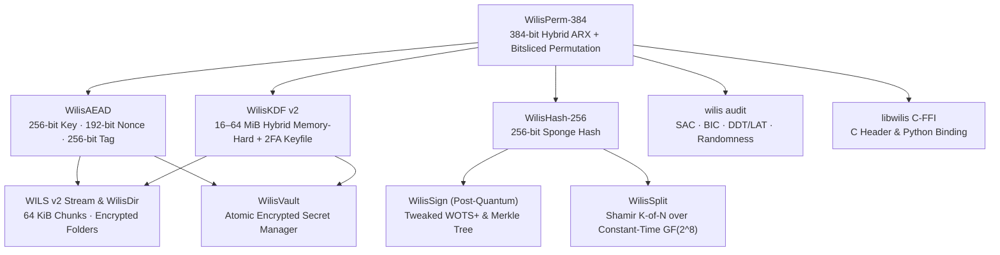

<div align="center">

# WILIS

### Standalone, Zero-Dependency Custom Cryptography Suite in Pure Rust

[](https://github.com/wiersect/wilis/actions/workflows/ci.yml)
[](https://github.com/wiersect/wilis/releases)
[](https://www.rust-lang.org/)
[](Cargo.toml)
[](.github/workflows/ci.yml)
[](LICENSE)

*One original 384-bit permutation. Zero external crypto libraries. Authenticated encryption, hybrid memory-hard KDF, post-quantum hash-based signatures, Shamir secret sharing, encrypted folders & vaults, cross-platform C/Python bindings, and live cryptanalysis.*

[Architecture](#architecture) · [Specification](SPECIFICATION.md) · [Audit Results](#verified-cryptanalysis--benchmarks) · [CLI Quickstart](#cli-quickstart) · [C / Python FFI](#c--python-bindings) · [Security](SECURITY.md)

</div>

---

## Overview

**Wilis** is a self-contained cryptographic engineering suite written 100% in pure Rust (`std` only, **zero external dependencies**). Every cryptographic primitive derives strictly from a single original **384-bit bijective permutation (`WilisPerm-384`)**:

| Module | Primitive | Key Security Guarantees |
| :--- | :--- | :--- |
| **`core/`** | **`WilisPerm-384`** | Hybrid ARX + constant-time bitsliced `Chi-5`/`Feistel-6` + invertible 3-tap diffusion; zero S-Box lookup tables |
| **`aead/`** | **`WilisAEAD`** | 256-bit key, 192-bit nonce, 256-bit tag, 256-bit sponge capacity, dual key whitening, key-commitment |
| **`kdf/`** | **`WilisKDF` v2** | **16–64 MiB** hybrid memory-hard KDF (data-independent Pass 0 + data-dependent Passes `1..T`) + **2FA Keyfile** |
| **`hash/`** | **`WilisHash-256`** | Incremental & one-shot 256-bit sponge hash with 128-bit collision resistance margin |
| **`sign/`** | **`WilisSign`** | **Post-quantum** stateful hash-based signatures (`WOTS+` + Merkle tree) built strictly from `WilisHash-256` |
| **`split/`** | **`WilisSplit`** | Information-theoretic **Shamir's Secret Sharing** (`K`-of-`N`) over constant-time `GF(2^8)` with commitment verification |
| **`stream/`** | **`WILS` v2 Stream** | Constant-memory 64 KiB chunked streaming AEAD blocking truncation, reordering, duplication, and tampering |
| **`archive/`** | **`WilisDir`** | Custom recursive folder archiver (`WDIR` v1) hiding filenames & hierarchy + strict Zip-Slip protection |
| **`vault/`** | **`WilisVault`** | Encrypted local secret & password store (`WVLT` v1) with atomic saves and memory zeroization |
| **`audit/`** | **`wilis audit`** | Scientific cryptanalysis suite: round-by-round SAC (1–16), BIC, exact DDT/LAT, NIST-style randomness battery |
| **`ffi/`** | **`libwilis` C-ABI** | Native shared/static library (`include/wilis.h` + zero-dependency Python 3 wrapper `bindings/python/wilis_py.py`) |

## Architecture



---

## Verified Cryptanalysis & Benchmarks

Measured directly via `./target/release/wilis audit` and `./target/release/wilis bench`:

| Verification Check | Measured Result | Target / Ideal | Status |
| :--- | :--- | :--- | :---: |
| **Bijectivity** `P⁻¹(P(x)) == x` | Exact identity across rounds 1, 4, 12, 16 | Exact 1-to-1 bijection | **PASS** |
| **Full Diffusion Round** (SAC 384-bit) | **Round 2** (`191.98/384` = `49.99%`) | ≤ Round 4 (10–14 round margin) | **PASS** |
| **Full-Round Avalanche** (Round 16) | **`191.99 / 384` bits (`50.00%`)** | `192.00` bits (`50.00%`) | **PASS** |
| **Bit Independence Criterion (BIC)** | Avg `\|corr\| = 0.0348`, Max `0.1641` | Avg `< 0.06`, Max `< 0.25` | **PASS** |
| **`Chi-5` S-Box Exact DDT / LAT** | Bijective, Diff Unif `8`, Nonlinearity `8` | Paired with ARX degree-63 carries | **PASS** |
| **Keystream Randomness** (128 KiB) | Entropy **`7.99853` bits/B**, Monobit `0.50007`, Runs `Z=0.87`, χ² `267.85` | NIST SP 800-22 bounds | **PASS** |
| **`WilisAEAD` Throughput** (Release) | **`~218–251 MiB/s`** (pure Rust, no SIMD) | Authenticated 256-bit security | **PASS** |
| **Cross-Platform CI & Test Suite** | **`26 / 26` tests passing** (Linux, macOS, Windows) | Zero warnings, zero dependencies | **PASS** |

---

## Build & Verify

```bash
git clone https://github.com/wiersect/wilis.git
cd wilis

# Run all 26 cryptographic, post-quantum, Shamir, streaming, vault, and FFI tests
cargo test

# Build optimized CLI binary + native shared library (libwilis.so / .dylib / .dll)
cargo build --release

# Run scientific cryptanalysis audit, benchmark, and Python FFI self-test
./target/release/wilis audit
./target/release/wilis bench
python3 bindings/python/wilis_py.py
```

---

## CLI Quickstart

### 1. Text, File & Full-Directory Encryption
```bash
# Hidden password prompt + Paranoid 64 MiB memory-hard KDF
./target/release/wilis encrypt-text --pass-prompt --strength paranoid "Hello Wilis!"

# Constant-memory chunked streaming file encryption with 2FA Keyfile
./target/release/wilis encrypt-file --pass-prompt --keyfile my.key --strength high --in data.bin --out data.wils
./target/release/wilis decrypt-file --pass-prompt --keyfile my.key --in data.wils --out restored.bin

# Encrypt an entire folder (hiding all filenames and directory structure)
./target/release/wilis encrypt-dir --pass-prompt --strength high --in ./secrets_folder --out ./secrets.wils
./target/release/wilis decrypt-dir --pass-prompt --in ./secrets.wils --out ./restored_folder
```

### 2. Post-Quantum Digital Signatures (`WilisSign`)
```bash
# Generate a post-quantum WOTS+ Merkle keypair (default height 6 = 64 one-time signatures)
./target/release/wilis sign-keygen --out mykey --height 6

# Sign a file (atomically advances stateful leaf counter in mykey.wsk)
./target/release/wilis sign --sk mykey.wsk --in release.tar.gz --out release.tar.gz.wsig

# Verify authenticity using only the public key
./target/release/wilis verify --pk mykey.wpk --in release.tar.gz --sig release.tar.gz.wsig
```

### 3. Shamir's Secret Sharing (`WilisSplit`)
```bash
# Split a 256-bit hex key into 5 shares requiring any 3 to reconstruct
./target/release/wilis split-key --secret "<64-HEX-KEY>" --total 5 --threshold 3

# Reconstruct the original key from any 3 shares
./target/release/wilis combine-key "wilis-share-v1:..." "wilis-share-v1:..." "wilis-share-v1:..."
```

### 4. Encrypted Local Secret Vault (`WilisVault`)
```bash
./target/release/wilis vault init --file vault.wils --pass-prompt --strength high
./target/release/wilis vault set  --file vault.wils --pass-prompt --name api_key --value "sk-live-..."
./target/release/wilis vault list --file vault.wils --pass-prompt
./target/release/wilis vault get  --file vault.wils --pass-prompt --name api_key
./target/release/wilis vault del  --file vault.wils --pass-prompt --name api_key
```

---

## C & Python Bindings

Compile the native shared library (`cargo build --release`) and call `libwilis` from C (`include/wilis.h`) or Python (`bindings/python/wilis_py.py`):

```python
from bindings.python.wilis_py import Wilis

w = Wilis()
key = w.random_bytes(32)
nonce = w.random_bytes(24)

ciphertext, tag = w.aead_seal(key, nonce, b"context", b"Hello from Python!")
plaintext = w.aead_open(key, nonce, b"context", ciphertext, tag)
assert plaintext == b"Hello from Python!"
```

---

## Repository Layout

Clean flat-root architecture — every cryptographic domain has its own directory and single-responsibility files:

```text
wilis/
├── Cargo.toml                  # Zero-dependency crate manifest (rlib + cdylib + staticlib)
├── README.md / SPECIFICATION.md / SECURITY.md / CONTRIBUTING.md / CHANGELOG.md / LICENSE
├── lib.rs / main.rs / error.rs # Library, CLI, and error entry points
├── core/                       # WilisPerm-384 core permutation
├── aead/                       # WilisAEAD duplex sponge authenticated encryption
├── kdf/                        # WilisKDF v2 hybrid memory-hard KDF (16–64 MiB + 2FA)
├── hash/                       # WilisHash-256 sponge hash
├── sign/                       # WilisSign post-quantum WOTS+ Merkle signatures
├── split/                      # WilisSplit Shamir K-of-N over constant-time GF(2^8)
├── format/                     # WILS v1 & v2 container headers and sealing
├── stream/                     # Constant-memory chunked streaming AEAD
├── archive/                    # WilisDir encrypted folder archiver (Zip-Slip safe)
├── vault/                      # WilisVault atomic encrypted secret store
├── audit/                      # Scientific cryptanalysis suite (SAC, BIC, DDT/LAT, NIST)
├── ffi/                        # C-ABI exports (libwilis)
├── include/wilis.h             # C99 FFI header
├── bindings/python/wilis_py.py # Zero-dependency Python 3 ctypes wrapper
├── utils/                      # Cross-platform CSPRNG (Unix/Windows), constant-time, zeroize, prompt
├── cli/                        # Zero-dependency CLI commands & parser
└── tests/                      # 26 integration, security, post-quantum, Shamir, vault, and FFI tests
```

---

## Security Notice

> **Important:** Wilis is a custom, independent cryptographic design created for cryptographic engineering research, education, and experimentation. Like any newly invented cipher, it has not undergone multi-year external public cryptanalysis. Do **not** rely on custom cryptography alone for regulated, financial, or mission-critical production systems — use peer-reviewed standards (AES-GCM, ChaCha20-Poly1305, Argon2id, ML-DSA/SLH-DSA) for production workloads. See **[`SECURITY.md`](SECURITY.md)**.

## License

Licensed under the **[MIT License](LICENSE)**.
